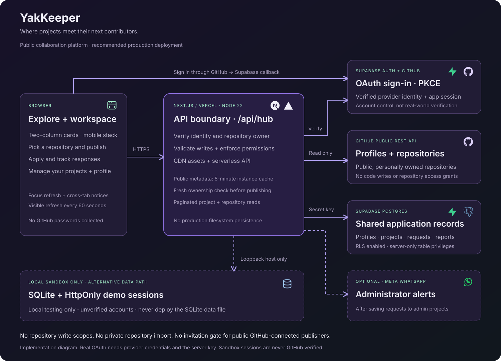

# YakKeeper

<p align="center"></p>

**Find teammates and contribute to public GitHub projects.** YakKeeper helps project owners meet people who want to learn, share ideas and build together.

[Open YakKeeper](https://yakkeeper.vercel.app/) · [Run locally](#run-locally) · [Environment variables](#environment-variables) · [Deploy](#deploy-your-own-instance) · [Security](.github/SECURITY.md)

Built for people learning by building, including beginners and first-time contributors. Owners keep their repositories on GitHub; YakKeeper handles project discovery and collaboration proposals.

## How it works

1. **Explore:** browse public projects, search by project, skills or owner, and filter by project type. Expand a card for its description and follow its repository link.
2. **Publish:** sign in with GitHub, select a public repository you own, and choose its type, status and visibility. The name and description come from GitHub. Add an optional banner and describe the help you need, if you want.
3. **Apply:** send an idea or a contribution request explaining what you would bring. A message is required; a blank request cannot be submitted.
4. **Review:** owners manage received requests in **Applications**; applicants track their sent requests there. Accepting records a decision in YakKeeper. Accepted contributors become project members and can use the shared task board. Acceptance does **not** grant GitHub repository access.

**My projects** contains your own listings, joined projects and pending invitations. Only owners see listing editing controls. Owners can close requests, change visibility, replace banners or delete a listing. Deletion removes its YakKeeper applications, ideas, reports and banner; the GitHub repository stays untouched. **Reports** is an administrator-only queue for flagged listings.

Public listings appear in Explore. Private listings are visible only to their owner; archived listings leave public discovery. Beginner-friendly labels help contributors find suitable work. Light and dark themes and a responsive project grid are included.

## GitHub access and boundaries

GitHub handles authentication; YakKeeper never receives your GitHub password and requests no repository write permissions. Account ownership is checked server-side. Repository import supports personally owned public repositories, not private or organization repositories.

Repository details refresh when a listing is saved. YakKeeper does not continuously synchronize issues, commits or collaborator permissions. A GitHub sign-in proves control of that account, not a person's experience or real-world identity.

The hosted application has been checked with GitHub sign-in and public repository discovery. Automated tests cover multiple local personas; the full two-real-account OAuth workflow needs separate integration verification. WhatsApp remains disabled by default and live delivery is not verified.

## Members, invitations and sharing

Each owner has a **Members** panel: look up a GitHub username, confirm the account, and send an invitation. Recipients accept or decline in **My projects**. Owners can cancel pending invitations or remove a member from that project. Invitations stay tied to the verified GitHub account ID if its username changes. Existing accepted contributors are preserved as members independently of application-history limits.

Use **How people join** in the editor to choose **Open applications** or **Invite only**. A public invite-only project stays in Explore; its Join button is disabled, while ideas can still be submitted when requests are open. Private listings remain owner-only. These controls do not manage GitHub repository permissions, send email, or request repository write scopes.

**Copy share link** gives a direct `/projects/<id>` page. Owners can highlight a starter task, effort, and an optional GitHub issue from the connected repository. Sharing a listing does not expose the private team board or member list.

## Shared project task boards

Open **Task board** on a project you own or have joined through an accepted contribution request. Plan tasks in **Future**, **Ongoing**, and **Finished**. Owners and accepted members can create tasks and change their status, including reopening finished work. Use **I'm working on this** to add yourself; several members can work on the same task, and each person controls their own participation.

Boards are team-only. Pending applicants, accepted idea submissions, blocked accounts, and declined members cannot access them. Members cannot access private or archived listings; owners can read archived boards. A task assignment does not grant GitHub access. Boards refresh on window focus, every 20 seconds while visible, and after changes; use **Refresh** for an immediate update. Each board supports up to 200 active tasks, with task creation limited to five per member per minute.

Owners and task creators can edit task titles/details. Owners can archive tasks and restore them from **Archived**; archived work does not count toward the active limit, and its participants are retained.

For a new deployment, apply all ordered files in `supabase/migrations` before deploying the application. These migrations are already applied to the existing YakKeeper database. See [task board verification](docs/task-boards.md) for behavior and checks.

## Run locally

Install Git and **Node.js 22.x** with npm, then clone the repository:

```sh
git clone https://github.com/4Raisan/YakKeeper.git
cd YakKeeper
npm ci
```

Copy the environment template (PowerShell):

```powershell
Copy-Item .env.example .env.local
```

On macOS/Linux, use `cp .env.example .env.local`. In that file, set `YAKKEEPER_LOCAL_DEMO=true`, then run:

```sh
npm run dev
```

Open [localhost](http://127.0.0.1:3000/). Choose **Try it / Switch account → Load test workspace** for four personas, two project owners and eight applications. Switch between accounts to try publishing, applying and reviewing. Sandbox identities are not GitHub verified; data persists in ignored `.local/yakkeeper.sqlite`.

The sandbox needs no Supabase credentials, GitHub OAuth app or Meta account. For real GitHub login locally, configure the values below and set `YAKKEEPER_LOCAL_DEMO=false`.

## Environment variables

[`.env.example`](.env.example) is the configuration template. Store local values in **`.env.local` at the repository root**; enter hosted values in the deployment platform's environment settings. Never commit `.env.local` or server credentials.

### Core configuration

| Variable | Needed for | Value and source |
| --- | --- | --- |
| `NEXT_PUBLIC_SUPABASE_URL` | Real sign-in and hosted mode | Supabase project URL, from its connection/API settings. |
| `NEXT_PUBLIC_SUPABASE_PUBLISHABLE_KEY` | Real sign-in and hosted mode | Supabase **publishable** key; intentionally browser-visible. |
| `SUPABASE_SECRET_KEY` | Hosted server/database access | Supabase **secret** key. Server-only; never prefix with `NEXT_PUBLIC_`. |
| `YAKKEEPER_LOCAL_DEMO` | Explicit mode selection | `true` for the localhost sandbox; **`false` for every hosted deployment**. Template default: `false`. |
| `OWNER_EMAIL` | Optional administrator setup | Verified sign-in email used to assign the administrator role when that account's profile is first created. Ordinary publishers do not need it. |
| `APP_URL` | Optional WhatsApp inbox links | Final website origin, such as `https://your-project.vercel.app`. Must be HTTPS when alerts are enabled. The template uses localhost; this value does not configure OAuth redirects. |

The three Supabase values must belong to the **same project**. The secret key has elevated database access; server routes authorize requests before using it. Keep it in server environment settings. See Supabase's [API key guidance](https://supabase.com/docs/guides/getting-started/api-keys).

`OWNER_EMAIL` does not update roles on existing profiles: changing it alone does not promote someone who already signed in. For isolated local test databases, the optional developer override `YAKKEEPER_LOCAL_DB` changes the SQLite file path; otherwise `.local/yakkeeper.sqlite` is used.

### Optional WhatsApp configuration

Leave `WHATSAPP_ENABLED=false` to run without Meta setup. These settings only enable alerts for proposals on the administrator's own projects:

| Variable | Purpose |
| --- | --- |
| `WHATSAPP_ENABLED` | Explicit opt-in: `true` enables configured alerts; default `false`. |
| `META_WHATSAPP_TOKEN` | Secret server access token for the WhatsApp Cloud API. |
| `META_PHONE_NUMBER_ID` | Meta's numeric sending phone-number ID, not the recipient number. |
| `META_GRAPH_VERSION` | Supported Graph API version from your Meta configuration. |
| `WHATSAPP_TO` | Administrator recipient in international format; keep this contact data private. |
| `WHATSAPP_TEMPLATE` | Approved template name with request kind, project title and inbox URL parameters. |
| `WHATSAPP_LANGUAGE` | Approved template language; default `en_US`. |

`APP_URL` is also required for alerts. Provider acceptance does not confirm delivery. This version has no delivery webhooks, automatic retries or recipient-wide subscriptions. Follow [WhatsApp setup and limits](docs/whatsapp.md) before enabling it.

## Deploy your own instance

The deployment uses **Vercel + Supabase**: a Node.js API, managed Postgres, GitHub OAuth and private banner storage. It cannot run as a static-only export. No Vercel Blob setup is required.

1. **Prepare Supabase.** Create a project and obtain its URL, publishable key and server secret. On a **fresh database**, apply every SQL file in [`supabase/migrations/`](supabase/migrations) in filename order. They create the tables, permissions and banner bucket. Do not replay migrations against an already migrated database.
2. **Create a GitHub OAuth App.** Set its homepage to your website and its authorization callback to the URL shown in Supabase's GitHub provider settings, normally `https://<project-ref>.supabase.co/auth/v1/callback`.
3. **Enable GitHub in Supabase Auth.** Enter the GitHub client ID and client secret **there**, not in `.env.local` or Vercel. Use the default profile/email permissions; do not add repository write scopes. Disable the unused email/password provider for this GitHub-only application. See the [official GitHub sign-in guide](https://supabase.com/docs/guides/auth/social-login/auth-github).
4. **Import the repository into Vercel.** Use the root directory containing `package.json`, select Next.js and Node.js **22.x**, install with `npm ci`, build with `npm run build`, and use the default Next.js output directory.
5. **Set deployment variables.** Add the three Supabase values above and set `YAKKEEPER_LOCAL_DEMO=false`. Optionally set `OWNER_EMAIL` before the administrator's first sign-in. Set `APP_URL` to the final HTTPS origin for notification links, and leave WhatsApp disabled until configured. Use a separate Supabase project for staging if you need data isolation.
6. **Configure return URLs.** In Supabase Auth URL Configuration, set the Site URL to the deployed HTTPS origin and allow both `https://<your-host>/` and `https://<your-host>/?view=my`. For real OAuth on localhost, also allow `http://127.0.0.1:3000/` and `http://127.0.0.1:3000/?view=my`. These website return URLs differ from GitHub's Supabase callback in step 2.
7. **Redeploy and verify.** Environment changes require a restart/redeploy; `NEXT_PUBLIC_*` values are bundled at build time. Keep `.env.local`, `.local/`, `.next/` and `node_modules/` out of Git.

Before using a new deployment, test with **two real GitHub accounts**: publish as an owner, apply as another user, review as the owner, refresh both inboxes and check sign-out. Confirm users cannot edit another owner's listing or read someone else's proposals. Check private/archived visibility and banner upload/removal too.

See [setup and deployment](docs/setup.md) for operational details. Monitor your hosting/database usage; the repository does not guarantee free hosting at any traffic level.

## Architecture



The React board calls the Next.js `/api/hub` route. The server verifies GitHub-backed Supabase sessions, checks listing ownership and roles, validates inputs and applies rate limits before accessing Postgres. Application tables are server-managed; direct anonymous/authenticated table access is denied. Banners use private Supabase Storage with expiring signed URLs. The localhost sandbox substitutes SQLite and test identities.

Banners use Supabase Storage, **not Vercel Blob**. Optional WhatsApp administrator alerts are implemented behind a disabled setting; Meta setup and real delivery verification are still pending. See [WhatsApp setup and limits](docs/whatsapp.md).

## Repository map

| Path | Purpose |
| --- | --- |
| `src/app/` | Pages, project board, styles and API route |
| `src/lib/` | Validation, authentication, repository import, storage and notifications |
| `src/tests/` | API, permissions and multi-persona regression tests |
| `public/brand/` | Website logo and favicon |
| `supabase/migrations/` | Ordered database and storage migrations |
| `docs/` | Setup guide, design notes, banner and architecture diagram |
| `.github/` | CI workflow and security policy |

Framework configuration, the lockfile and environment template stay at the root so standard tooling works without extra setup.

## Commands and contributing

| Command | Purpose |
| --- | --- |
| `npm run dev` | Start development on `127.0.0.1:3000` |
| `npm run typecheck` | Check TypeScript without generating output |
| `npm test` | Run the Node.js regression suite |
| `npm run build` | Build and type-check production output |
| `npm start` | Serve an existing production build locally |

Open an issue describing the problem or proposed change, or send a focused pull request with reproduction steps and relevant validation. Install dependencies, make your change, then run:

```sh
npm run typecheck
npm test
npm run build
```

Tests cover validation, ownership, application privacy, moderation, deletion and multiple local personas. They do not replace testing OAuth with two real GitHub accounts or verifying WhatsApp delivery. CI also runs a dependency audit. Include relevant checks in your pull request; use [private security reporting](.github/SECURITY.md) for vulnerabilities.

## Troubleshooting

| Symptom | Check |
| --- | --- |
| GitHub sign-in is unavailable | Set all three Supabase variables, enable GitHub in Supabase, and restart/redeploy. For a credential-free trial, use the localhost sandbox. |
| OAuth reports incorrect credentials | Check the client ID/secret saved in **Supabase's GitHub provider** and the OAuth App's Supabase callback URL. |
| Login returns to the wrong host | Check Supabase's Site URL and exact redirect allowlist; changing `APP_URL` alone does not configure OAuth. |
| Server reports incomplete configuration or missing tables | Confirm all keys use the same Supabase project and check migration state. Never expose the server secret in browser code. |
| Repository is absent from the picker | It must be public, personally owned and not archived. Check GitHub API errors/rate limits before retrying. |
| Administrator controls are missing | `OWNER_EMAIL` must match the verified email when the profile is first created; existing roles are stored in the database. |
| Banner fails | Use PNG, JPEG or WebP up to 8 MB. Check private bucket migrations and server storage access. Images are cropped to 3:1 and compressed to at most 128 KiB. |
| WhatsApp alert is absent | Alerts are disabled by default and administrator-project-only. Check [Meta setup and limits](docs/whatsapp.md); proposals remain saved even when notification fails. |

## License

[MIT](LICENSE) — Copyright © 2026 4Raisan. Dependency licenses remain with their respective authors.
